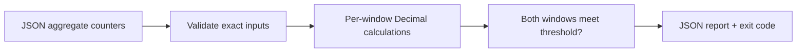

# SLO Budget Lab

An offline Python demo for request-based SLO burn-rate analysis. Feed it synthetic aggregate request/error counters and receive per-window error ratios, burn rates and two-window alert decisions. It does not connect to monitoring systems or send alerts.

## Run

```bash
python -m venv .venv
. .venv/bin/activate
pip install -e '.[dev]'
slolab examples/clear.json
slolab examples/firing.json
```

The second command returns exit code `1` because its synthetic data fires an alert; that is expected, not a crash. Full example reports are in [clear-report.json](examples/clear-report.json) and [firing-report.json](examples/firing-report.json).

## Calculation

With target `"0.999"`, the allowed error ratio is `0.001`. If 200 of 10,000 requests fail, the observed error ratio is `0.02` and its burn rate is `20`:

```text
allowed error ratio = 1 − target
observed error ratio = errors / requests
burn rate = observed error ratio / allowed error ratio
```

A burn rate of 20 means errors consume the permitted fraction at twenty times the target rate for that window. It does not state the remaining monthly budget, forecast an outage or prove business impact.



### Demo rules

| Rule | Short window | Long window | Required burn rate in both |
| --- | --- | --- | --- |
| fast | 5m | 1h | ≥ 14.4 |
| slow | 30m | 6h | ≥ 6 |

A spike in only the short window does not fire a rule. These fixed thresholds are illustrative, not a recommended paging policy for every service. They are evaluated independently; if either known rule fires, the overall state is `firing` even if the other rule lacks data.

## Input contract

```json
{
  "target": "0.999",
  "windows": {
    "5m": {"requests": 10000, "errors": 200},
    "1h": {"requests": 120000, "errors": 2400},
    "30m": {"requests": 60000, "errors": 900},
    "6h": {"requests": 720000, "errors": 7200}
  }
}
```

- Target is an exact decimal string strictly between zero and one. Floating-point JSON targets are rejected to avoid accidental binary rounding.
- Counts are non-negative integers; booleans and fractional values are rejected. Errors cannot exceed requests.
- The top-level keys are exactly `target` and `windows`; only the four named windows are accepted.
- Missing or null windows are `missing`. A zero-request window is `no_traffic`. Neither is silently treated as healthy.
- A rule missing either usable window is `insufficient_data`. The overall state is `clear` only when both rules have sufficient data and neither fires.
- Decimal calculations use a local 40-digit precision context. Ratios are returned as strings to preserve that representation; recurring divisions are rounded to this precision.

The caller must supply aligned windows ending at the same instant, a consistent request/error definition and complete counters. There are no timestamps or completeness assertions in this deliberately small schema, so the tool cannot verify those assumptions or detect stale telemetry.

## Library and automation

```python
from slolab.core import evaluate

report = evaluate({"target": "0.999", "windows": {}})
assert report["state"] == "insufficient_data"
```

| Exit | Meaning |
| --- | --- |
| 0 | All rules evaluable and clear |
| 1 | At least one rule firing |
| 2 | Invalid input / file error |
| 3 | No firing rule, but insufficient telemetry |

Successful reports go to stdout; invalid-input diagnostics go to stderr. No input files are changed.

## Checks and boundaries

```bash
pytest -q
ruff check .
ruff format --check .
python -m pip wheel --no-deps . -w dist
```

CI tests and builds on Python 3.11 and 3.12. Tests exercise inclusive thresholds, one-window spikes, missing/zero traffic, malformed counts and targets, Decimal context isolation and CLI status codes.

This is a portfolio demo on synthetic counters, not a production monitoring service or past employment claim. It has no Prometheus queries, rolling-window aggregation, counter-reset handling, persistence, deduplication, notification delivery, authentication or availability guarantee. Runtime dependencies are Python standard library only.
